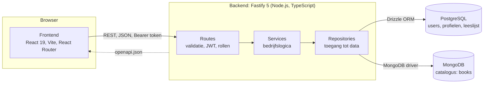
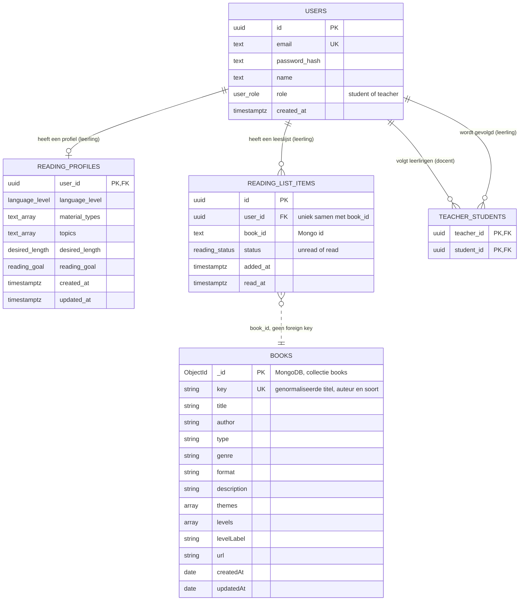

# Smart Reading Coach API

De backend van **Smart Reading Coach** (project "Vrij lezen op maat", Avans ICT SE2.1). De API levert de catalogus, het leesprofiel, het leesadvies, de leeslijst en de docentenweergave. De React frontend staat in de map `smart-reading-coach` en praat met deze API.

Inhoud: [Techniek](#techniek) · [Lokaal draaien](#lokaal-draaien) · [Scripts](#scripts) · [Mappenstructuur](#mappenstructuur) · [Architectuur](#architectuur) · [Dataopslag](#dataopslag) · [Authenticatie](#authenticatie-en-autorisatie) · [API](#api-overzicht) · [Adviesalgoritme](#adviesalgoritme) · [Tests](#tests) · [Coding style](#coding-style) · [Een wijziging doen](#een-kleine-wijziging-doen) · [Requirements](#requirements)

## Techniek

| Onderdeel            | Keuze                                                  |
| -------------------- | ------------------------------------------------------ |
| Runtime en taal      | Node.js 20.6 of hoger, TypeScript (strict), ES modules |
| Webframework         | Fastify 5 met JSON schema validatie per route          |
| Relationele database | PostgreSQL 16 via Drizzle ORM en drizzle-kit migraties |
| Documentdatabase     | MongoDB 7 (de catalogus met titels)                    |
| Authenticatie        | JWT (`@fastify/jwt`), wachtwoorden met bcrypt          |
| Tests                | Node test runner (`node:test`) met tsx                 |
| Kwaliteit            | ESLint 10, Prettier, EditorConfig                      |

## Lokaal draaien

Je hebt Node.js 20.6 of hoger en Docker nodig.

```bash
# 1. Afhankelijkheden installeren
npm install

# 2. Instellingen kopieren en invullen (zie de tabel hieronder)
cp .env.example .env          # Windows: copy .env.example .env

# 3. PostgreSQL en MongoDB starten
docker compose up -d

# 4. Tabellen aanmaken, demo accounts toevoegen en de catalogus importeren
npm run db:migrate
npm run db:seed
npm run import:catalog

# 5. De API starten met automatisch herladen
npm run dev
```

De API draait dan op `http://localhost:3000`. Controleer met `http://localhost:3000/api/health`: die meldt of PostgreSQL en MongoDB bereikbaar zijn.

Start daarna de frontend (zie de README in `smart-reading-coach`).

### Instellingen (`.env`)

| Variabele               | Betekenis                                                                    | Standaard               |
| ----------------------- | ---------------------------------------------------------------------------- | ----------------------- |
| `PORT`, `HOST`          | Waar de API luistert                                                         | `3000`, `0.0.0.0`       |
| `CORS_ORIGIN`           | Adres van de frontend                                                        | `http://localhost:5173` |
| `POSTGRES_URL`          | Verbinding met PostgreSQL                                                    | zie `.env.example`      |
| `MONGO_URL`, `MONGO_DB` | Verbinding met MongoDB en de databasenaam                                    | zie `.env.example`      |
| `JWT_SECRET`            | Geheim waarmee tokens worden ondertekend, kies een lange willekeurige waarde | verplicht               |
| `JWT_EXPIRES_IN`        | Levensduur van een token                                                     | `8h`                    |

Het bestand `.env` staat in `.gitignore` en wordt nooit gecommit.

### Demo accounts

`npm run db:seed` maakt twee accounts aan die aan elkaar gekoppeld zijn. Gebruik ze alleen lokaal.

| Rol      | Email                 | Wachtwoord     |
| -------- | --------------------- | -------------- |
| Docent   | `teacher@example.com` | `Password123!` |
| Leerling | `student@example.com` | `Password123!` |

### Opnieuw beginnen

`docker compose down -v` verwijdert de containers en beide databases. Draai daarna stap 3 en 4 opnieuw. `npm run import:catalog` mag je vaker draaien: bestaande titels worden bijgewerkt in plaats van dubbel opgeslagen.

## Scripts

| Script                                   | Doel                                                                    |
| ---------------------------------------- | ----------------------------------------------------------------------- |
| `npm run dev`                            | API starten met herladen bij wijzigingen                                |
| `npm run build`                          | TypeScript compileren naar de map `dist`                                |
| `npm start`                              | De gebouwde versie starten (`dist/server.js`)                           |
| `npm run typecheck`                      | Types controleren zonder bestanden te schrijven                         |
| `npm run lint`, `npm run lint:fix`       | ESLint draaien, eventueel met automatische fixes                        |
| `npm run format`, `npm run format:check` | Prettier toepassen of controleren                                       |
| `npm test`                               | Alle unit tests draaien                                                 |
| `npm run test:ci`                        | Tests met coverage en een JUnit bestand, zoals de pipeline ze draait    |
| `npm run check`                          | Typecheck, lint, formatcontrole en tests in één keer                    |
| `npm run db:generate`                    | Een nieuwe migratie maken na een wijziging in `src/db/schema.ts`        |
| `npm run db:migrate`                     | Migraties uitvoeren                                                     |
| `npm run db:seed`                        | Demo accounts aanmaken                                                  |
| `npm run import:catalog`                 | De Excel catalogus in `data/leescatalogus.xlsx` naar MongoDB importeren |
| `npm run openapi`                        | De OpenAPI specificatie schrijven naar `openapi.json`                   |

## Mappenstructuur

```
src/
    server.ts            start de server
    app.ts               bouwt de Fastify app: plugins, documentatie en routes registreren
    config.ts            leest de omgevingsvariabelen
    errors.ts            HttpError met een statuscode en een foutcode
    i18n.ts              leest teksten uit locales/nl.json (t, describeError) en kiest de taal (resolveLocale)
    locales/             nl.json: foutmeldingen en teksten van het advies
    routes/              HTTP laag: validatie, autorisatie, aanroepen van een service (index.ts registreert ze allemaal)
    services/            bedrijfslogica (auth, profiel, advies, leeslijst, docent, mapping)
    repositories/        toegang tot de databases, geen bedrijfslogica
    entities/            typen van wat in de databases staat (User, ReadingProfile, ReadingListItem, Book)
    dto/                 typen van wat de API teruggeeft of ontvangt
    advice/              scoring en motivatieteksten van het advies
    catalog/             Excel importeren en rijen normaliseren
    profile/             toegestane waarden van het leesprofiel
    readingList/         statussen van de leeslijst
    auth/                rollen
    db/                  Drizzle schema, migratie en seed
    plugins/             Fastify plugins: postgres, mongo, auth, locale, errorHandler
    openapi/             gedeelde schema's, documentatie-instellingen en de generator van openapi.json
    scripts/             losse commando's, zoals de catalogusimport
    types/               uitbreiding van de Fastify typen
tests/                   unit tests
drizzle/                 gegenereerde SQL migraties
data/                    de catalogus als Excel bestand
openapi.json             gegenereerde API specificatie (npm run openapi)
```

## Architectuur

### Systeemoverzicht



De frontend praat alleen met de API. De API is de enige die de databases aanspreekt. De stippellijn is het contract: de API beschrijft zichzelf in `openapi.json` en de frontend genereert daar zijn types uit (zie OpenAPI hieronder).

### Lagen

De code is opgebouwd in vaste lagen. Een verzoek gaat er altijd in dezelfde volgorde doorheen:

```
route  ->  service  ->  repository  ->  database
```

- **Route**: valideert de invoer met een JSON schema, controleert het token en de rol, roept één service aan en geeft het resultaat terug.
- **Service**: bevat de regels van de applicatie. Een service krijgt zijn repositories als parameter (dependency injection), zodat tests eenvoudig nepversies kunnen meegeven zonder database.
- **Repository**: praat met PostgreSQL of MongoDB en weet niets van HTTP of regels.

**Entities en DTO's.** Een _entity_ beschrijft wat de database opslaat (`entities/`), een _DTO_ wat de API teruggeeft (`dto/`). Ze zijn bewust gescheiden: zo lekt een intern veld, zoals de wachtwoordhash of het Mongo `_id`, nooit per ongeluk naar buiten. De omzetting van entity naar DTO staat op één plek, in `services/mappingService.ts`.

**Foutafhandeling.** Services gooien een `HttpError` met een statuscode en een intern _foutcode_, bijvoorbeeld `throw new HttpError(409, 'auth.emailTaken')`. De code is getypeerd: een code die niet in `locales/nl.json` staat compileert niet. De code verlaat de backend niet: `plugins/errorHandler.ts` maakt er een tekst van in de taal van het verzoek en verstuurt die als problem details (RFC 9457, `Content-Type: application/problem+json`). Ook de fouten van Fastify zelf (ongeldige invoer, onbekende route) worden zo omgezet en bij een serverfout blijven technische details uit het antwoord.

**Taal.** De client stuurt de gewenste taal mee in de `Accept-Language` header, bijvoorbeeld `nl`. `plugins/locale.ts` kiest met `resolveLocale` de beste taal die de backend heeft (de `q` waarden tellen mee, `nl-BE` wordt `nl`) en zet die op `request.locale`. Is er geen header of is de taal onbekend, dan is het Nederlands. Het antwoord bevat `Content-Language` en `Vary: Accept-Language`.

**Teksten.** Teksten die de backend zelf maakt staan in `src/locales/nl.json` en worden opgehaald met `t('advice.motivation.topics', { topics }, locale)` uit `i18n.ts`. Dat zijn de foutmeldingen en de motivatie en beschrijving in het advies; die gebruiken allebei `request.locale`. Voor een tweede taal komt er een bestand met dezelfde sleutels bij (bijvoorbeeld `en.json`) en wordt het in `i18n.ts` aan `catalogs` toegevoegd. De frontend hoeft dan alleen de taal door te geven.

## Dataopslag

Elk soort data staat in de opslag die er het beste bij past.

**PostgreSQL** bevat de gegevens met sterke relaties, met constraints en foreign keys:

| Tabel                | Inhoud                                                   |
| -------------------- | -------------------------------------------------------- |
| `users`              | Accounts met rol `student` of `teacher`                  |
| `teacher_students`   | Welke leerling aan welke docent gekoppeld is             |
| `reading_profiles`   | Het leesprofiel, één per leerling                        |
| `reading_list_items` | De leeslijst, uniek per combinatie van leerling en titel |

**MongoDB** bevat de catalogus in de collectie `books`. Titels hebben wisselende metadata (boeken hebben een genre, artikelen alleen thema's), en dat past bij een documentdatabase. Een uniek veld `key` (genormaliseerde titel, auteur en soort) voorkomt dubbele titels bij het importeren. Een titel in de leeslijst verwijst met het Mongo id naar de catalogus. De koppeling tussen beide databases gebeurt in `readingListService`.

### ERD



De vier bovenste tabellen staan in PostgreSQL en worden beheerd met Drizzle (`src/db/schema.ts`) en SQL migraties in `drizzle/`. `BOOKS` staat in MongoDB. Een foreign key tussen beide databases bestaat niet, daarom controleert `readingListService` bij het toevoegen dat de titel in de catalogus staat. Verwijder je een gebruiker, dan verdwijnen profiel, leeslijst en koppelingen mee (`ON DELETE CASCADE`).

## OpenAPI en het contract met de frontend

De API beschrijft zichzelf met OpenAPI 3.0. Het contract wordt niet apart bijgehouden: dezelfde JSON schema's die de routes gebruiken om invoer te valideren en antwoorden te serialiseren, worden door `@fastify/swagger` omgezet in de specificatie.

- **Swagger UI**: met de API gestart staat de interactieve documentatie op `http://localhost:3000/api/docs`. Klik op _Authorize_ en plak een token uit `POST /api/auth/login` om beveiligde routes uit te proberen.
- **`openapi.json`**: `npm run openapi` schrijft de specificatie naar dit bestand. Het bestand staat in git en de frontend genereert er zijn TypeScript types uit (`npm run api:types` in de frontend). Dat werkt zonder draaiende databases, omdat het script de routes registreert met een lege vervanger voor de databaseverbindingen (`src/openapi/buildSpec.ts`).
- **Gedeelde schema's** staan in `src/openapi/schemas.ts` (`Book`, `ReadingListItem`, `ProblemDetails` en andere). Routes verwijzen ernaar met `{ $ref: 'Book#' }`. Elke route heeft een tag, samenvatting, beveiligingseis en alle antwoorden die kunnen voorkomen. Foutantwoorden zijn `application/problem+json`.
- **Antwoordschema's zijn ook een vangnet**: Fastify serialiseert antwoorden met het schema, dus een veld dat niet in het schema staat komt niet in het antwoord.

Wijzig je een route of schema, draai dan `npm run openapi` en commit `openapi.json`. De test `tests/openapi.test.ts` faalt als het bestand niet meer klopt met de code, als een route geen documentatie heeft, of als een DTO niet meer past bij zijn schema.

## Authenticatie en autorisatie

- Inloggen levert een JWT met het gebruikers id (`sub`) en de rol.
- Elke route behalve registreren, inloggen en de health check vraagt een geldig token via `fastify.authenticate`.
- Routes die alleen voor één rol zijn, gebruiken `fastify.authorize('student')` of `fastify.authorize('teacher')`.
- Een docent ziet alleen leerlingen die zichzelf aan die docent hebben gekoppeld. Dat wordt in `teacherService` afgedwongen en geeft anders een 403.

## API overzicht

Alle paden beginnen met `/api`.

| Methode en pad                                                      | Wie      | Doel                                                                                                                                                         |
| ------------------------------------------------------------------- | -------- | ------------------------------------------------------------------------------------------------------------------------------------------------------------ |
| `POST /auth/register`                                               | iedereen | Account aanmaken (rol leerling)                                                                                                                              |
| `POST /auth/login`                                                  | iedereen | Inloggen, geeft een token                                                                                                                                    |
| `GET /auth/me`                                                      | ingelogd | Huidige gebruiker                                                                                                                                            |
| `GET /books`                                                        | ingelogd | Catalogus met zoeken, filters en paginering (`search`, `type`, `level`, `theme` (elk herhaalbaar, bijvoorbeeld `theme=humor&theme=oorlog`), `page`, `limit`) |
| `GET /books/filters`                                                | ingelogd | Beschikbare waarden voor de filters                                                                                                                          |
| `GET /books/:id`                                                    | ingelogd | Eén titel                                                                                                                                                    |
| `GET /profile/options`                                              | leerling | Keuzes voor het leesprofiel                                                                                                                                  |
| `GET /profile/me`, `PUT /profile/me`                                | leerling | Eigen leesprofiel lezen en opslaan                                                                                                                           |
| `GET /advice`                                                       | leerling | Drie tot vijf suggesties met motivatie                                                                                                                       |
| `GET /reading-list`, `POST /reading-list`                           | leerling | Leeslijst ophalen en een titel toevoegen                                                                                                                     |
| `PATCH /reading-list/:id`, `DELETE /reading-list/:id`               | leerling | Status wijzigen (gelezen of niet gelezen) en verwijderen                                                                                                     |
| `GET /teachers`                                                     | leerling | Docenten en of je aan ze gekoppeld bent                                                                                                                      |
| `PUT /teachers/:teacherId/link`, `DELETE /teachers/:teacherId/link` | leerling | Koppelen en ontkoppelen                                                                                                                                      |
| `GET /students`                                                     | docent   | Gekoppelde leerlingen                                                                                                                                        |
| `GET /students/:studentId`                                          | docent   | Leesprofiel en leeslijst van een gekoppelde leerling                                                                                                         |
| `POST /students/:studentId/reading-list`                            | docent   | Een titel toevoegen aan de leeslijst van een leerling                                                                                                        |
| `GET /health`                                                       | iedereen | Status van beide databases                                                                                                                                   |

### Foutantwoorden

Elke fout is een problem details object volgens RFC 9457, met `Content-Type: application/problem+json`. `detail` is de tekst voor de gebruiker, in de taal van de `Accept-Language` header van het verzoek. De API stuurt geen eigen foutcodes mee.

```json
{
    "type": "about:blank",
    "title": "Bad Request",
    "status": 400,
    "detail": "Kies maximaal 5 onderwerpen",
    "instance": "/api/profile"
}
```

Clients reageren op `status`, niet op de tekst. De codes hieronder zijn intern en bepalen alleen welke tekst uit `locales/nl.json` komt.

| Code                                                                            | Status        | Betekenis                                                                              |
| ------------------------------------------------------------------------------- | ------------- | -------------------------------------------------------------------------------------- |
| `auth.notLoggedIn`, `auth.forbidden`                                            | 401, 403      | Geen of verlopen token, of de rol mag dit niet                                         |
| `auth.accountGone`, `auth.emailTaken`, `auth.invalidCredentials`                | 401, 409, 401 | Account bestaat niet meer, e-mailadres in gebruik, onjuiste inloggegevens              |
| `books.notFound`                                                                | 404           | Titel niet gevonden                                                                    |
| `advice.profileRequired`                                                        | 409           | Eerst het leesprofiel invullen                                                         |
| `profile.tooManyTopics` (`max`), `profile.unknownTopics` (`topics`)             | 400           | Te veel of onbekende onderwerpen                                                       |
| `readingList.bookNotInCatalog`, `alreadyOnList`, `itemNotFound`                 | 404, 409, 404 | Titel onbekend, al op de lijst, item niet gevonden                                     |
| `teachers.notFound`, `students.notLinked`, `students.notFound`                  | 404, 403, 404 | Docent of leerling onbekend, leerling niet gekoppeld                                   |
| `validation.required` (`field`), `invalidFormat`, `empty`, `tooLong`, `invalid` | 400           | Ongeldige invoer, `field` is de naam van het veld in het verzoek, bijvoorbeeld `email` |
| `validation.invalidEmail`, `validation.passwordTooShort` (`min`)                | 400           | Ongeldig e-mailadres, te kort wachtwoord                                               |
| `generic.badRequest`, `generic.notFound`, `generic.server`                      | 400, 404, 500 | Kapot verzoek, onbekende route, onverwachte fout (zonder technische details)           |

## Adviesalgoritme

Het advies is regelgebaseerd en uitlegbaar. De logica staat in `advice/scoring.ts`, de gewichten in de constante `WEIGHTS`.

1. Titels die moeilijker zijn dan het niveau van de leerling vallen af.
2. Elke overgebleven titel krijgt punten: niveau exact (3), makkelijker niveau (1), per overeenkomend onderwerp (3), gewenste soort tekst (2), passende lengte (1) en passend bij het leesdoel (1). De catalogus heeft geen aantal bladzijden, dus de lengte wordt geschat op basis van de soort tekst.
3. De hoogste scores worden aangeboden, maximaal vijf. Zijn er te weinig treffers, dan wordt de selectie verbreed naar alles op het niveau van de leerling, zodat er altijd minstens drie suggesties zijn.
4. De tekst "Waarom dit bij je past" (`advice/motivation.ts`) wordt alleen opgebouwd uit de redenen die echt overeenkwamen.

## Tests

```bash
npm test
```

De unit tests dekken de kernlogica, zonder database:

| Bestand                      | Wat wordt getest                                                                                                                                                             |
| ---------------------------- | ---------------------------------------------------------------------------------------------------------------------------------------------------------------------------- |
| `scoring.test.ts`            | Puntentelling, te moeilijke titels, motivatietekst en het randgeval van een titel zonder niveau                                                                              |
| `adviceService.test.ts`      | Eerst een profiel invullen, beste treffer bovenaan, minstens drie suggesties, nooit een te moeilijke titel                                                                   |
| `profileService.test.ts`     | Opslaan van het profiel, dubbele waarden, onbekende onderwerpen, meer dan vijf onderwerpen                                                                                   |
| `readingListService.test.ts` | Toevoegen, dubbele of onbekende titels, sortering, verwijderde catalogustitels, niet bij andermans item kunnen, gelezen of ongelezen zetten                                  |
| `teacherService.test.ts`     | Alleen gekoppelde leerlingen zijn zichtbaar en bewerkbaar, koppelen en ontkoppelen van docenten                                                                              |
| `errorHandler.test.ts`       | Foutantwoorden als problem details in de taal van het verzoek, ongeldige invoer, onbekende route, geen technische details bij een crash                                      |
| `i18n.test.ts`               | Teksten ophalen en invullen, taal kiezen uit `Accept-Language`, geen lege teksten in `nl.json`, veldnamen bij validatiefouten                                                |
| `openapi.test.ts`            | Elke route staat in de specificatie met tag, samenvatting en beveiliging, `openapi.json` is actueel, DTO's en antwoorden passen bij de schema's, fouten zijn problem details |
| `normalizeRow.test.ts`       | Het omzetten en opschonen van rijen uit de Excel catalogus, inclusief waarschuwingen bij ontbrekende gegevens                                                                |

## CI/CD en deployment

De pipeline staat in `.github/workflows/ci-cd.yml` (GitHub Actions) en draait bij elke push en pull request.

| Job                    | Wat hij doet                                                                                                                                                                                                                                     |
| ---------------------- | ------------------------------------------------------------------------------------------------------------------------------------------------------------------------------------------------------------------------------------------------ |
| `Build, lint and test` | `npm ci`, typecheck, ESLint, Prettier controle, tests met coverage (`npm run test:ci`), productiebuild en een Docker build. Het testrapport en de coverage staan in de samenvatting van de run, het JUnit bestand is te downloaden als artifact. |
| `Dependency scan`      | `npm audit --audit-level=high`: de pipeline faalt bij een bekende ernstige kwetsbaarheid.                                                                                                                                                        |
| `Deploy to Render`     | Alleen op `main` en pas als beide jobs groen zijn. Start via een deploy hook een deploy van precies deze commit, wacht tot Render meldt dat hij live is en doet een smoke test op `/api/health`.                                                 |

Maak in de branch protection van `main` de checks `Build, lint and test` en `Dependency scan` verplicht, dan kan een rode pipeline niet gemerged worden. De test `openapi.test.ts` zorgt er ook voor dat `openapi.json` altijd bij de code past.

### Waar draait wat

| Onderdeel  | Dienst                       | Waarom                                                                              |
| ---------- | ---------------------------- | ----------------------------------------------------------------------------------- |
| API        | Render, web service (Docker) | Gratis, bouwt de `Dockerfile` en wordt beschreven in `render.yaml`.                 |
| Website    | Render, static site          | Gratis en slaapt nooit. Zie de `render.yaml` van de frontend.                       |
| PostgreSQL | Neon                         | Blijvend gratis (1 GB). De gratis database van Render wordt na 30 dagen verwijderd. |
| MongoDB    | MongoDB Atlas (M0)           | Blijvend gratis (512 MB).                                                           |

De gratis API slaapt na 15 minuten zonder verkeer en heeft ongeveer een minuut nodig om wakker te worden. Het eerste verzoek na een pauze is dus traag. Neon wordt ook na een paar minuten stilgezet en start automatisch weer op.

### Eenmalig inrichten

1. **Neon.** Maak op neon.tech een gratis project aan (regio Frankfurt). Kopieer de connection string, die eindigt op `?sslmode=require`.
2. **MongoDB Atlas.** Maak op cloud.mongodb.com een gratis M0 cluster. Maak een databasegebruiker aan, zet onder Network Access het adres `0.0.0.0/0` open (Render heeft geen vast IP) en kopieer de `mongodb+srv://` string met je wachtwoord erin.
3. **Render, API.** Kies op render.com New, Blueprint en koppel deze repository. Render leest `render.yaml` en vraagt om `POSTGRES_URL`, `MONGO_URL` en `CORS_ORIGIN`. Vul `CORS_ORIGIN` voorlopig met `https://smart-reading-coach.onrender.com` in, je past dit in stap 6 aan. Het JWT geheim wordt door Render zelf gemaakt. De eerste deploy draait de migraties.
4. **Deploy hook en API key.** Open de service, Settings, Deploy Hook, en kopieer de URL. Maak onder Account Settings, API Keys een key aan.
5. **GitHub.** Maak in deze repository onder Settings, Environments een environment `production`. Zet daarin de secrets `RENDER_DEPLOY_HOOK_URL` en `RENDER_API_KEY` en de variabele `API_URL` (bijvoorbeeld `https://smart-reading-coach-api.onrender.com`).
6. **De website.** Doe stap 3 tot en met 5 ook voor de frontend repository. Daar vraagt Render om `VITE_API_URL`, bijvoorbeeld `https://smart-reading-coach-api.onrender.com/api`, en de variabele in GitHub heet `WEB_URL`. Pas daarna in de API service `CORS_ORIGIN` aan naar het echte adres van de website.
7. **Data laden.** De gratis Render services hebben geen shell, dus laad de data vanaf je eigen computer. Zet in PowerShell de gegevens van Neon en Atlas in de omgeving en draai de scripts:
    ```powershell
    $env:POSTGRES_URL = '<neon string>'
    $env:MONGO_URL = '<atlas string>'
    npm run db:seed
    npm run import:catalog
    ```
    Omgevingsvariabelen gaan voor op `.env`, dus je `.env` hoef je niet aan te passen. Het seed script maakt de demo accounts aan, ook het docentaccount. Verander de wachtwoorden als je de website deelt.
8. **Deploy.** Push naar `main` of start de workflow handmatig onder Actions. Daarna is elke push naar `main` met groene checks automatisch live.

### Docker

De `Dockerfile` bouwt in drie stappen een kleine image zonder dev dependencies die als gewone gebruiker draait. Bij het starten worden eerst de migraties uitgevoerd. Lokaal proberen: `docker build -t smart-reading-coach-api .`

## Coding style

De stijl wordt afgedwongen door tooling, dus je hoeft er niet over na te denken: `npm run format` past hem toe en `npm run check` controleert hem. De instellingen staan in `.editorconfig`, `.prettierrc.json` en `eslint.config.js`.

| Onderwerp             | Afspraak                                                                                                           |
| --------------------- | ------------------------------------------------------------------------------------------------------------------ |
| Inspringen            | 4 spaties, geen tabs                                                                                               |
| Regelbreedte          | maximaal 100 tekens                                                                                                |
| Quotes en puntkomma's | enkele quotes, altijd een puntkomma                                                                                |
| Trailing commas       | overal waar dat kan                                                                                                |
| Regeleinden           | LF                                                                                                                 |
| Namen                 | `camelCase` voor variabelen en functies, `PascalCase` voor typen en interfaces, `UPPER_SNAKE_CASE` voor constanten |
| Bestanden             | `camelCase.ts`, per soort een eigen map                                                                            |
| Imports               | met de `.js` extensie (NodeNext), typen met `import type`                                                          |
| Typen                 | `strict` staat aan, `any` vermijden                                                                                |
| ESLint                | `no-floating-promises`, `consistent-type-imports`, `eqeqeq`, `no-console` (behalve in scripts), `no-deprecated`    |

Commentaar in de code is Engels, teksten die een gebruiker ziet zijn Nederlands.

## Een kleine wijziging doen

Voorbeeld: een extra leesdoel toevoegen, bijvoorbeeld `culture`.

1. Voeg `'culture'` toe aan `READING_GOALS` in `src/profile/profileOptions.ts`.
2. Draai `npm run typecheck`. TypeScript wijst nu de plekken aan die je nog moet aanvullen: `GOAL_TEXT` in `advice/motivation.ts` en `TYPES_BY_GOAL` in `advice/scoring.ts`.
3. Het database enum is van dezelfde lijst afgeleid. Draai `npm run db:generate` en daarna `npm run db:migrate`.
4. Voeg een test toe in `tests/scoring.test.ts` en draai `npm run check`.
5. Voeg in de frontend het label toe aan `GOAL_LABELS` (`src/constants/labels.ts`).

## Requirements

| Requirement                              | Waar te vinden                                                   |
| ---------------------------------------- | ---------------------------------------------------------------- |
| FR1 en FR2, leesprofiel                  | `profileService`, `routes/profile.ts`, tabel `reading_profiles`  |
| FR3, advies met motivatie                | `advice/`, `adviceService`                                       |
| FR4, catalogus met filters en paginering | `routes/books.ts`, `bookRepository`                              |
| FR5, leeslijst                           | `readingListService`, tabel `reading_list_items`                 |
| FR6, docenten                            | `teacherService`, `teacherLinkService`, tabel `teacher_students` |
| NFR1, consistente architectuur           | Vaste lagen: route, service, repository                          |
| NFR2, README en coding style             | Dit bestand                                                      |
| NFR3, tests op de kernlogica             | `tests/`                                                         |
| NFR6, JWT en rollen                      | `plugins/auth.ts`, `authorize` op elke route                     |
| NFR7, passende dataopslag                | PostgreSQL voor relaties, MongoDB voor de catalogus              |

## Bekende beperkingen

- Het advies is nog regelgebaseerd. Een AI model volgt in een latere fase.
- Er zijn unit tests, maar nog geen integratietests tegen een echte database.
